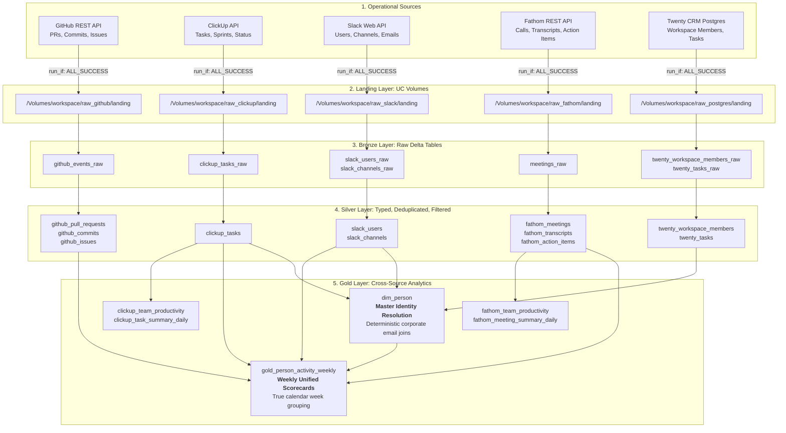

# 🌊 Marketing Boutique Lakehouse: Complete Data Flow, System Integration & Hermes AI Guide

> **Prepared for Leadership Review with Fenil & Usman**  
> **Repository:** `coders-boutique/action-os-twenty` (`services/data-engineering`)  
> **Pull Request:** [PR #46 (`feat/gold-cross-source`)](https://github.com/coders-boutique/action-os-twenty/pull/46)

---

## Executive Summary: Addressing Leadership Questions

This document answers the four strategic architecture and implementation questions raised by Fenil and Usman:
1. **[Define How the Complete Data Flow Works](#1-complete-end-to-end-data-flow-meeting-41154341)** (Slack, ClickUp, GitHub, Fathom, Twenty PostgreSQL ➔ Databricks ➔ Gold Models).
2. **[Connect the Pipeline to the Real System](#2-connecting-the-pipeline-to-the-real-system-meeting-39484115)** (Moving from personal sandbox to production workspace and company Twenty CRM database).
3. **[Explain How ActionOS / Hermes Will Use the Data](#3-how-actionos-and-hermes-ai-will-use-the-data-meeting-42374341)** (How Hermes AI and ActionOS dashboards query cross-mapped metrics for proactive intelligence).
4. **[Implementation Review and Integration with Usman](#4-implementation-review--integration-next-steps)** (Making changes reviewable, CI/CD validation, and deployment roadmap).

---

## 1. Complete End-to-End Data Flow (Meeting: 41:15–43:41)

The pipeline integrates **5 disparate operational tools** into a unified **Medallion Lakehouse** (`Land ➔ Bronze ➔ Silver ➔ Gold`) hosted on Databricks Serverless and Unity Catalog.



### Layer-by-Layer Processing:

#### 1. Landing Layer (Unity Catalog Volumes)
* **What it does:** Raw JSON responses extracted from APIs/databases are stored unmodified as immutable audit files in UC Volumes (`raw_<source>/landing/`).
* **Why it matters:** Zero data loss. If transformation logic changes later, the Lakehouse can reprocess historical files without re-querying external APIs.

#### 2. Bronze Layer (Raw Delta Tables)
* **What it does:** Ingests raw JSON payloads into append-only Delta Lake tables using Spark structured streaming checkpoints.
* **Audit Metadata:** Every row captures `_ingest_run_id` and `_ingest_timestamp` for provenance.

#### 3. Silver Layer (Cleaned, Typed, Deduplicated)
* **What it does:** Parses JSON schemas, casts data types, and applies critical business rules:
  * **Twenty CRM:** Filters out soft-deleted records (`payload.deletedAt.isNull()`).
  * **GitHub:** Separates merged PRs, commits, and pure issues (explicitly excluding PRs returned by the GitHub Issues endpoint).
  * **Slack:** Normalizes user profiles and preserves real corporate emails (`profile.email`).

#### 4. Gold Layer (Master Identity & Weekly Analytics)
* **`dim_person` (Master Team Identity):**
  * Harvests internal team profiles strictly from Twenty CRM `workspaceMember` (CRM leads/clients from `twenty_people` are excluded).
  * Enforces deterministic `GITHUB_TEAM_MAPPING` (`go2usman` ➔ `usman@codersboutique.com`, `nik-767` ➔ `deepak@codersboutique.com`, etc.).
  * Eliminates synthetic `@github.team` placeholder emails.
* **`gold_person_activity_weekly` (Unified Scorecard):**
  * Groups metrics by true calendar weeks (`date_trunc('week', event_time)`).
  * Pre-resolves GitHub authors to `primary_email` before joining, eliminating duplicate rows from `OR` joins.
  * Computes dynamic weekly scores (`github_score`, `slack_score`, `clickup_score`, `fathom_score`, `weekly_activity_score`) capped per week (not capped forever at 100).

---

## 2. Connecting the Pipeline to the Real System (Meeting: 39:48–41:15)

In personal sandbox testing (`-t personal`), tables used a `nikhil_` prefix in the `dev` schema. Connecting to the company's real production environment requires three steps:

### A. Pointing to the Official Production Workspace & Schemas
The production bundle configuration in `databricks.yml` removes personal prefixes and writes to official corporate schemas:
* **Target Workspace:** `https://dbc-44ca0102-48c3.cloud.databricks.com`
* **Catalog:** `workspace`
* **Official Production Schemas:**
  * Bronze: `raw_github`, `raw_clickup`, `raw_slack`, `raw_fathom`, `raw_postgres`
  * Silver: `silver` (e.g. `silver.clickup_tasks`, `silver.twenty_workspace_members`)
  * Gold: `gold` (e.g. `gold.dim_person`, `gold.gold_person_activity_weekly`)
* **Bundle Path:** `/Workspace/Shared/.bundle/mb-data-engineering/prod`

### B. Connecting to ActionOS Twenty PostgreSQL in Production
In production, Twenty CRM runs on a cloud-hosted PostgreSQL database (AWS RDS, Supabase, Neon, or cloud VPS):
1. In `databricks.yml` under `targets.prod.variables`:
   ```yaml
   targets:
     prod:
       mode: production
       variables:
         postgres_host: "twenty-db.production.yourdomain.com"
         postgres_port: "5432"
         postgres_user: "twenty_prod_user"
         postgres_database: "twenty"
         schedule_pause_status: UNPAUSED
   ```
2. Store the production database password in Databricks secret scope:
   ```bash
   databricks secrets put-secret mb-ingest postgres-password --profile prod
   ```
3. **Driver & Security:** The pipeline uses the pure-Python `pg8000` driver (native on Databricks Serverless without OS-level C dependencies) connecting over encrypted TLS. Ensure the cloud PostgreSQL firewall allows inbound connections from Databricks Serverless IPs.

### C. Local Development Support
For engineers developing locally with Docker Twenty CRM:
* We provide `python scripts/sync_postgres_local.py`, which extracts from local Docker (`twenty-db-1`) and uploads to their personal Databricks landing volume.
* `land_task.py` automatically detects existing local sync data in development while maintaining strict failure alerts in production.

---

## 3. How ActionOS and Hermes AI Will Use the Data (Meeting: 42:37–43:41)

This addresses Fenil's core architectural question: **What happens after ingestion? How does the Lakehouse power ActionOS and Hermes?**

```
┌────────────────────────────────────────────────────────────────────────┐
│                        Hermes AI & ActionOS UI                         │
│   (Conversational Assistant, Proactive Alerts, Executive Dashboard)   │
└───────────────────────────────────┬────────────────────────────────────┘
                                    │ SQL Queries via Databricks REST API
                                    ▼
┌────────────────────────────────────────────────────────────────────────┐
│                   Databricks Serverless SQL Warehouse                  │
│                     Catalog: workspace | Schema: gold                  │
├────────────────────────┬────────────────────────┬──────────────────────┤
│       dim_person       │ person_activity_weekly │  fathom_transcripts  │
│ (Master Team Identity) │ (Cross-Source Scores)  │ (Meeting Intel & AI) │
└────────────────────────┴────────────────────────┴──────────────────────┘
```

### 1. Unified Team Directory in ActionOS
* **Problem Solved:** Currently, Twenty CRM only knows CRM contacts. It has no visibility into who is working on what in GitHub or ClickUp.
* **Lakehouse Integration:** ActionOS queries `gold.dim_person` to display a single, unified team directory containing verified corporate emails, Slack user IDs, ClickUp assignees, and GitHub handles.

### 2. Conversational Executive Visibility via Hermes AI
Because all platform activities are linked to `dim_person`, Hermes AI can answer cross-platform questions that were previously impossible:
* **"Who is overloaded this week?"**  
  ➔ Hermes queries `gold.gold_person_activity_weekly` + `gold.clickup_team_productivity` to surface team members with disproportionate task counts and high meeting hours.
* **"What code was shipped by Usman's team this week?"**  
  ➔ Hermes joins `silver.github_pull_requests` with `gold.dim_person` on `primary_email` to list all merged PRs without guessing GitHub logins.
* **"Show me client meeting action items from this week."**  
  ➔ Hermes queries `silver.fathom_action_items` and `silver.fathom_meetings` filtered by meeting topic or client name.

### 3. Automated Bi-Directional Action OS Tasks
* **Fathom Action Item Ingestion:** Action items extracted by Fathom during client calls (`silver.fathom_action_items`) can be synced directly back into Twenty CRM tasks (`postgres.twenty_tasks`), ensuring promised client deliverables automatically appear on developer task boards.

---

## 4. Implementation Review & Integration Next Steps

To make this implementation completely reviewable and coordinate deployment with Usman:

### What Is Completed & Verified on PR #46:
* **Commit:** [`066982e`](https://github.com/coders-boutique/action-os-twenty/commit/066982e) on branch `feat/gold-cross-source`.
* **CI Quality Standards:**
  * **Linter:** `python -m ruff check .` passed with **0 errors**.
  * **Unit Tests:** `pytest tests/ingestion` passed **76/76 tests**.
  * **Gold Unit Tests:** Added `tests/transform/gold/test_dim_person.py` and `tests/transform/gold/test_person_activity.py`.
* **Live Databricks Verification:**
  * `postgres_ingest` ran end-to-end (`land` ➔ `bronze_load` ➔ `silver_load`) with status **`SUCCESS`** (Run ID `775559179217382`).
  * `gold_analytics` ran with status **`SUCCESS`**, harvesting **16 verified team members** and producing weekly scorecards for weeks `2026-10-12`, `2026-10-19`, and `2026-10-26`.

### Integration & Deployment Steps with Usman:
1. **PR Review on GitHub:**
   * Review [Pull Request #46](https://github.com/coders-boutique/action-os-twenty/pull/46). All changes are scoped strictly to `services/data-engineering/`.
2. **Merge to `main`:**
   * Merging triggers GitHub Actions workflow `.github/workflows/deploy.yml`.
3. **Production Deployment Command:**
   ```bash
   cd services/data-engineering
   databricks bundle deploy -t prod
   ```
   *This automatically unpauses the 5 daily ingestion jobs and the Gold analytics job at 5:00 AM, 6:00 AM, 7:00 AM, and 7:30 AM PST.*
