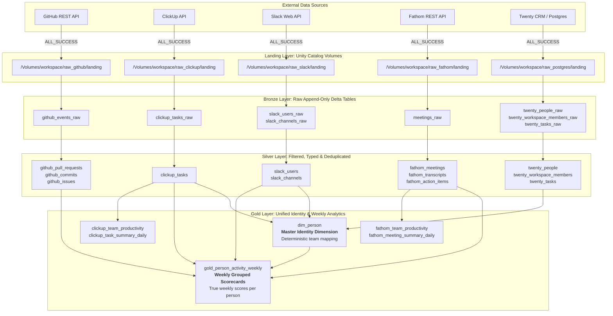

# 🚀 Marketing Boutique Lakehouse: Databricks Architecture & Deployment Guide

This guide provides the complete production architecture, configuration instructions, local development workflows, and deployment procedures for the Marketing Boutique Data Engineering Lakehouse on Databricks and Unity Catalog.

---

## 1. Lakehouse Medallion Architecture

The platform integrates 5 disparate SaaS tools into a unified Medallion Lakehouse (Land ➔ Bronze ➔ Silver ➔ Gold), resolving team identities into a single master dimension (`dim_person`) and calculating true weekly performance scorecards (`gold_person_activity_weekly`).



---

## 2. Lakehouse Table & Schema Inventory

| Source | Landing Volume | Bronze Table | Silver Tables | Gold Tables |
|---|---|---|---|---|
| **GitHub** | `raw_github/landing` | `github_events_raw` | `github_pull_requests`<br/>`github_commits`<br/>`github_issues` (pure issues, PRs excluded) | `gold_person_activity_weekly` |
| **ClickUp** | `raw_clickup/landing` | `clickup_tasks_raw` | `clickup_tasks` | `clickup_team_productivity`<br/>`clickup_task_summary_daily` |
| **Twenty CRM** | `raw_postgres/landing` | `twenty_people_raw`<br/>`twenty_workspace_members_raw`<br/>`twenty_tasks_raw` | `twenty_people`<br/>`twenty_workspace_members`<br/>`twenty_tasks` (soft-deleted rows filtered) | `dim_person` (internal staff harvested strictly from `workspace_members`) |
| **Slack** | `raw_slack/landing` | `slack_users_raw`<br/>`slack_channels_raw` | `slack_users` (with real `profile.email`)<br/>`slack_channels` | `dim_person`<br/>`gold_person_activity_weekly` |
| **Fathom** | `raw_fathom/landing` | `meetings_raw` | `fathom_meetings`<br/>`fathom_transcripts`<br/>`fathom_action_items` | `fathom_team_productivity`<br/>`fathom_meeting_summary_daily` |

---

## 3. Automated Ingestion & Analytics Schedule

In production, all jobs run automatically on calibrated, non-overlapping cron schedules:

| Time (PST) | Job Name | Tasks | Purpose |
|---|---|---|---|
| **05:00 AM** | `fathom_ingest` | `land` ➔ `bronze_load` ➔ `silver_load` ➔ `gold_load` | Ingests calls, transcripts, action items, and meeting metrics |
| **06:00 AM** | `slack_ingest` | `land` ➔ `bronze_load` ➔ `silver_load` | Ingests workspace channels and users (`users:read.email`) |
| **06:00 AM** | `clickup_ingest` | `land` ➔ `bronze_load` ➔ `silver_load` ➔ `gold_load` | Ingests tasks and builds ClickUp productivity metrics |
| **06:00 AM** | `postgres_ingest`| `land` ➔ `bronze_load` ➔ `silver_load` | Ingests Twenty CRM workspace members and tasks |
| **07:00 AM** | `github_ingest` | `land` ➔ `bronze_load` ➔ `silver_load` | Ingests PRs, commits, and non-PR standalone issues |
| **07:30 AM** | `gold_analytics`| `build_gold_dim_person` ➔ `build_gold_activity` | Builds master identity dimension and weekly scorecards |

All jobs enforce:
- `timeout_seconds: 1800` (30-minute safety cap)
- `max_concurrent_runs: 1` (prevents watermark race conditions)
- `retry_on_timeout: true`, `max_retries: 2`, `min_retry_interval_millis: 30000`
- `run_if: ALL_SUCCESS` on all downstream tasks (halts immediately on landing failure and sends alert)

---

## 4. Production Configuration Checklist (What to Change for Prod)

When deploying to the **Production** environment (`-t prod`), ensure the following items are configured:

### 1. Twenty CRM PostgreSQL Cloud Host & Firewall
In production, Twenty CRM runs on a cloud server (AWS RDS, Supabase, Neon, or a VPS). Under `targets.prod.variables` in `databricks.yml`:
```yaml
targets:
  prod:
    mode: production
    variables:
      postgres_host: "twenty-db.production.yourdomain.com"  # Real cloud host or public IP
      postgres_port: "5432"
      postgres_user: "twenty_prod_user"
      postgres_database: "twenty"
```
> [!IMPORTANT]
> **Firewall Whitelisting:** Ensure your cloud database firewall / AWS Security Group allows inbound connections on port 5432 from Databricks Serverless IP addresses (or via AWS PrivateLink / VPC Peering).

### 2. Production Databricks Secrets (`mb-ingest`)
Populate all required production tokens and passwords in the `mb-ingest` secret scope:
```bash
# Twenty CRM Database password
databricks secrets put-secret mb-ingest postgres-password --profile prod

# GitHub Personal Access Token (repo, read:org scopes)
databricks secrets put-secret mb-ingest github-token --profile prod

# ClickUp API Token (Workspace token)
databricks secrets put-secret mb-ingest clickup-api-token --profile prod

# Slack Bot Token (xoxb-...) with users:read.email scope
databricks secrets put-secret mb-ingest slack-bot-token --profile prod

# Fathom API Keys (per contributor)
databricks secrets put-secret mb-ingest fathom-api-key-fenil --profile prod
databricks secrets put-secret mb-ingest fathom-api-key-usman --profile prod
```

### 3. Production Alert Notifications
In `resources/*.yml`, update `email_notifications` on failure to your production alerts distribution list:
```yaml
email_notifications:
  on_failure:
    - "data-engineering-alerts@codersboutique.com"
```

### 4. Automatic Unpausing in Prod
In `targets.prod`, `schedule_pause_status` is configured as `UNPAUSED`. When deployed with `-t prod`, all schedules are automatically active.

---

## 5. Local Development Workflow (Using Local Docker Twenty CRM)

Because Databricks Serverless executes on cloud virtual machines, it cannot connect across the public internet to `localhost:5432` on your laptop. 

To use your local Twenty CRM Docker setup for development and testing:

1. **Ensure Twenty CRM Docker is Running:**
   ```bash
   # From your twenty docker directory
   docker compose up -d
   ```

2. **Sync Local Twenty CRM to Databricks Landing Volume:**
   Run the automated sync script from `services/data-engineering/`:
   ```bash
   python scripts/sync_postgres_local.py
   ```
   *This extracts `people`, `workspace_members`, and `tasks` from your local Docker container and uploads them directly to your personal Unity Catalog landing volume (`/Volumes/workspace/raw_postgres/landing/dev/<username>`).*

3. **Run or Trigger the Job in Databricks:**
   ```bash
   databricks bundle run postgres_ingest -t personal
   ```
   *The `land` task automatically detects your local sync data in the volume, advances watermarks, and runs `bronze_load` and `silver_load` successfully.*

---

## 6. How to Deploy

### Development / Personal Deployment:
```bash
cd services/data-engineering

# Validate bundle configuration
databricks bundle validate -t personal -p personal

# Deploy to personal dev target
databricks bundle deploy -t personal -p personal
```

### Production Deployment (Manual or CI/CD):
```bash
cd services/data-engineering

# Validate production bundle
databricks bundle validate -t prod -p prod

# Deploy production jobs and wheel to /Workspace/Shared/.bundle/mb-data-engineering/prod
databricks bundle deploy -t prod -p prod
```

On merging Pull Requests to the `main` branch, GitHub Actions automatically runs `databricks bundle deploy -t prod` using repository secrets (`DATABRICKS_HOST` and Service Principal credentials).
